# ELEC 4 - Python Programming


## Student Information

| Information | Details |
|---|---|
| Student Name | DANIEL EIDDERF P. MANAOIS |
| Section | IV-BSIT-A |
| Course | ELEC 4 - Python Programming |

## Repository Overview

This repository contains my self-paced learning activities
for ELEC 4 - Python Programming.

The projects demonstrate my understanding of functions,
modules, collections, exception handling, file operations,
recursion, and object-oriented programming.

## Set 1 - Python Fundamentals

**Development Branch:** `set-1`

| Activity | Description | Folder |
|---|---|---|
| P1 - Student Grade Calculator | Calculate and evaluate student grades using functions. | [View Activity](set1/p1/) |
| P2 - Custom Module: student_utils | Organize reusable grade calculation functions into a custom module. | [View Activity](set1/p2/) |
| P3 - Student Record Manager | Manage student records using lists and sets with duplicate prevention and partial searching. | [View Activity](set1/p3/) |
| P4 - Safe Menu Program | Handle invalid inputs, division errors, and missing files using exception handling. | [View Activity](set1/p4/) |

## Set 2 - Advanced Python

**Development Branch:** `set-2` (Planned)

| Activity | Description | Folder |
|---|---|---|
| P5 - Student Information File System | Store and manage student records using files. | Pending |
| P6 - Recursion Toolkit | Solve problems using recursive functions. | Pending |
| P7 - Student Management System with Classes | Apply classes, objects, and encapsulation. | Pending |
| P8 - Inheritance and Polymorphism | Demonstrate inheritance and method overriding. | Pending |

## Prerequisites

- Python 3
- Visual Studio Code (optional)
- Git

## Clone the Repository

```bash
git clone https://github.com/danieleidderfm-cpu/ELEC4-Python-Manaois.git
cd ELEC4-Python-Manaois
```

Before the Set 1 pull request is merged, use:

```bash
git checkout set-1
```

## How to Run the Activities

Run each command from the repository root.

### P1 - Student Grade Calculator

```bash
python set1/p1/p1_grade_calculator.py
```

Enter student grades, calculate the average, display the highest
and lowest grades, and determine the passing status.

### P2 - Custom Module

```bash
python set1/p2/p2_main.py
```

Enter grades and calculate the results using functions
imported from the student_utils module.

### P3 - Student Record Manager

```bash
python set1/p3/p3_record_manager.py
```

Use the menu to add, remove, search, and display student records.

### P4 - Safe Menu Program

```bash
python set1/p4/p4_exceptions.py
```

Use the menu to perform division and read files while
demonstrating exception handling.

## Program Screenshots

### P1 - Student Grade Calculator

#### Passing Grades

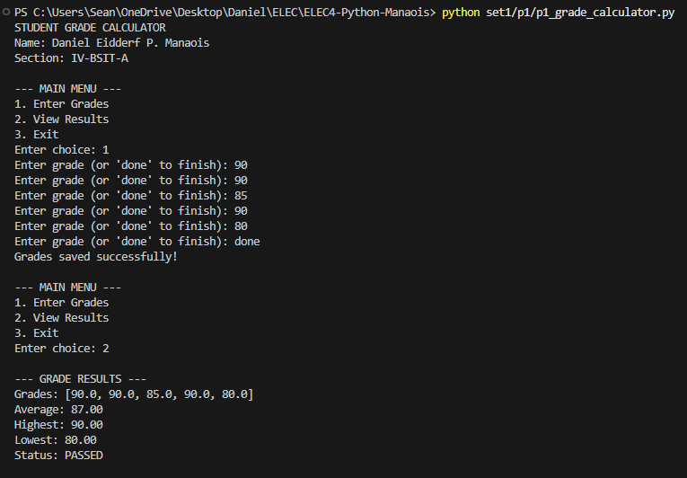

#### Failing Grades

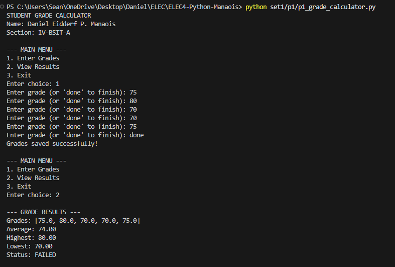

#### Input Validation

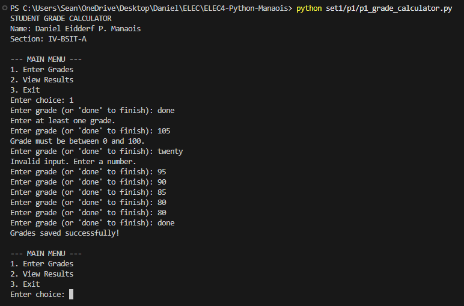

---

### P2 - Custom Module: student_utils

#### Passing Grades

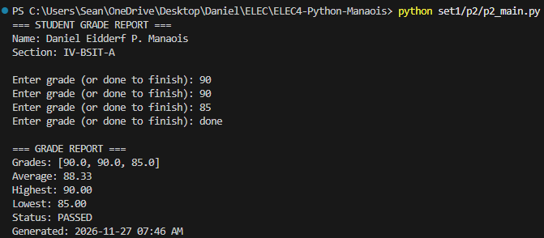

#### Failing Grades

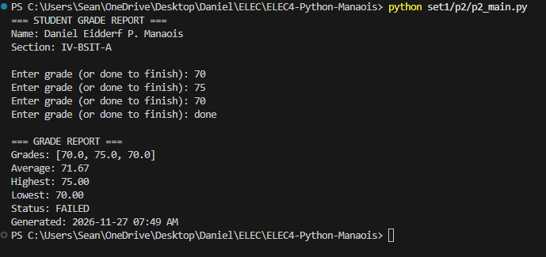

#### Input Validation

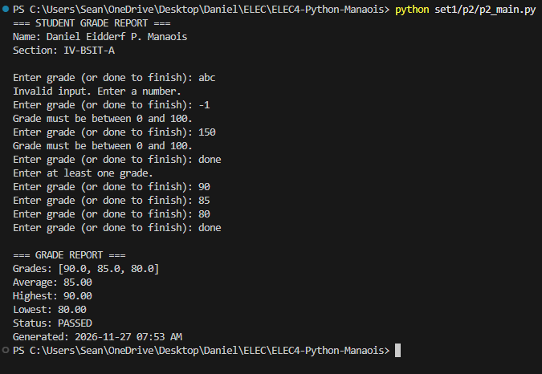

---

### P3 - Student Record Manager

#### Add Students

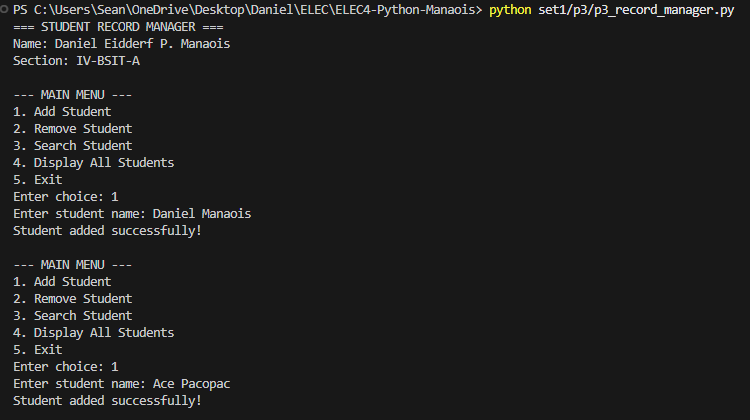

#### Duplicate Prevention

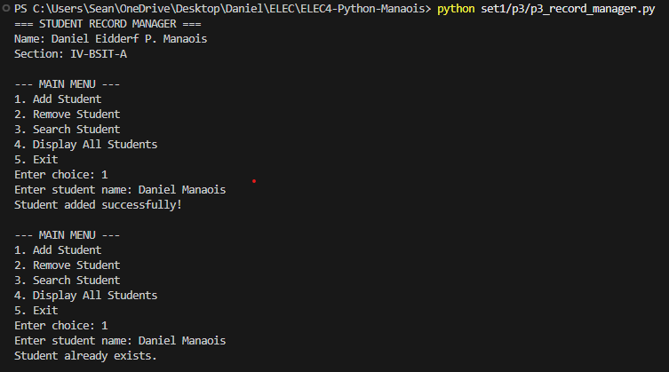

#### Search Students

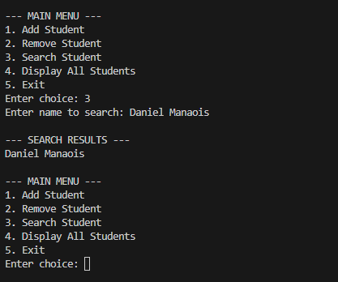

#### Display Student Records

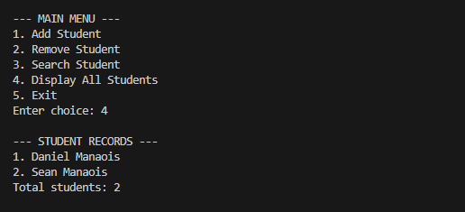

#### Remove Student

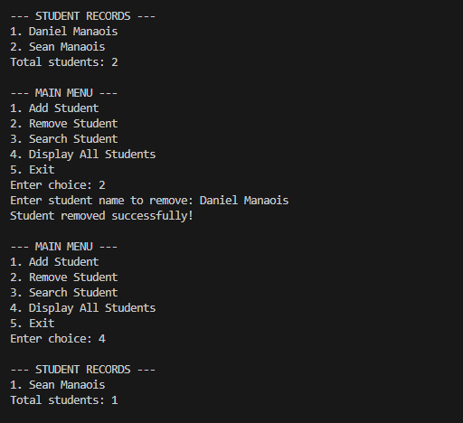

---

### P4 - Safe Menu Program

#### Invalid Number Input

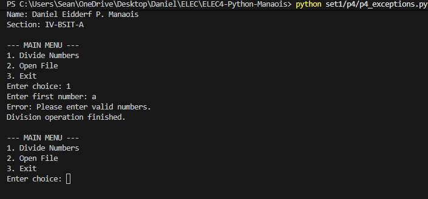

#### Division by Zero

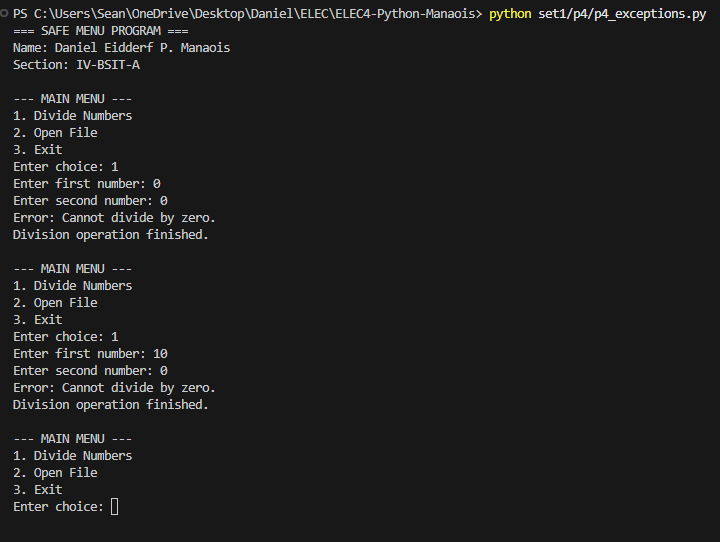

#### Missing File

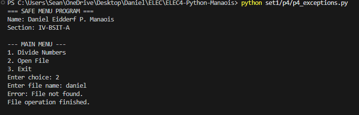

#### Invalid Menu Choice

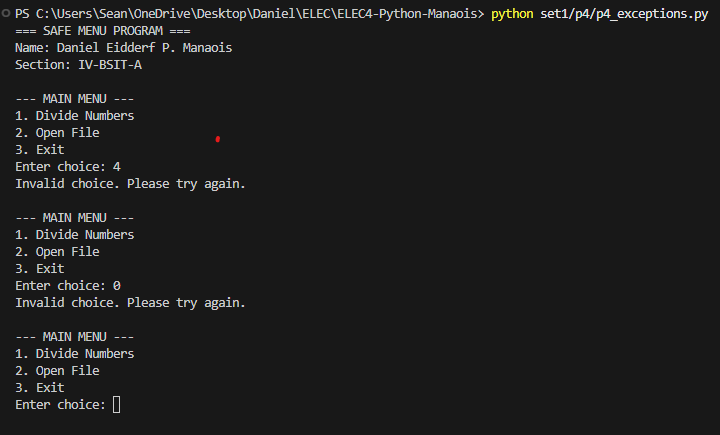

#### Successful Division

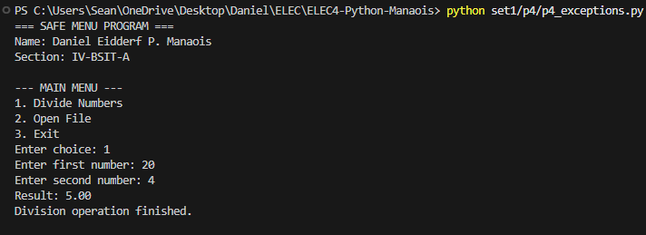

#### Successful File Reading

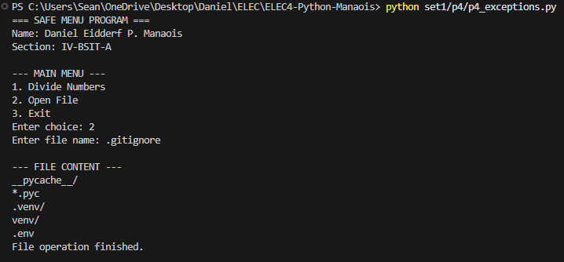

## Technologies Used

- Python
- Visual Studio Code
- Git
- GitHub

## Learning References

- [Python Full Course for Free - Bro Code](https://www.youtube.com/watch?v=ix9cRaBkVe0)
- [Official Python Documentation](https://docs.python.org/3/)

---

**Submitted by:** DANIEL EIDDERF P. MANAOIS

**Section:** IV-BSIT-A

**Course:** ELEC 4 - Python Programming

Academic Year 2026-2027
